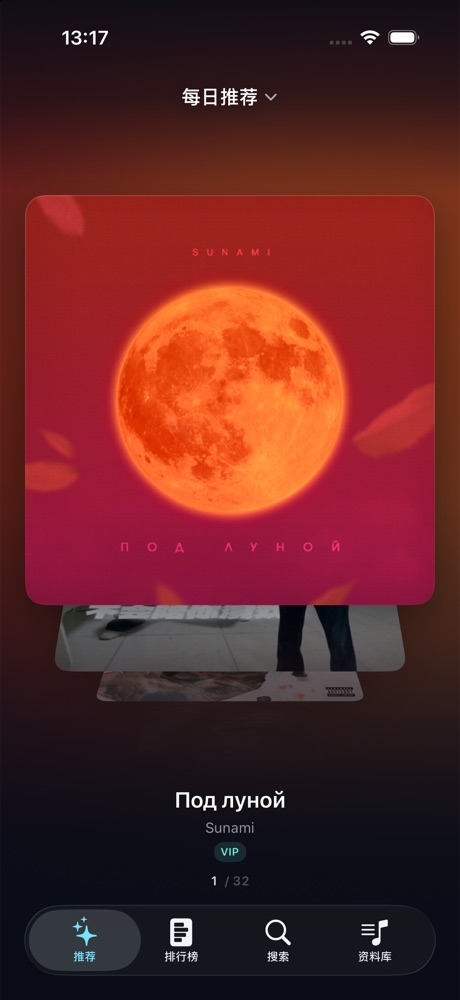
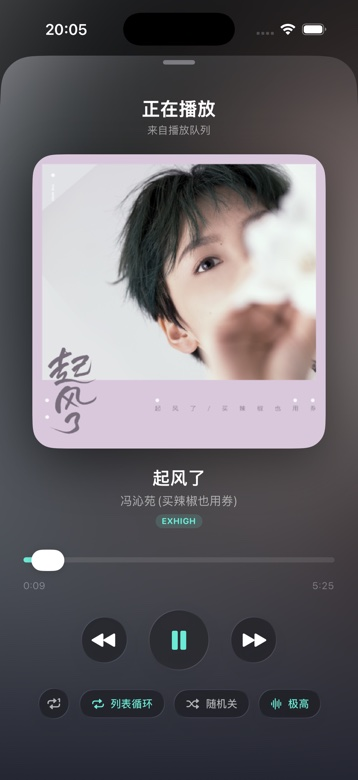

# Flow Music

一个用 SwiftUI 写的网易云音乐第三方客户端。首页是一摞可以上下翻的 **Cover Flow 唱片堆**，播放时封面走 HDR 提亮，进度是播放按钮外圈的一圈圆环。

<p align="center">
  
  
</p>

## 功能

- **纵向 Cover Flow 首页**：绕 X 轴旋转的 3D 牌堆，上下拖动切换、松手吸附；按下封面会轻微下沉，松手回弹。首页只有这一种形态。
- **歌单即牌堆**：每日推荐、漫游歌单、「我喜欢的音乐」和自建歌单都是牌堆来源。正在播放哪个歌单，首页就摆哪个；在资料库 / 搜索里点播也会自动跟过去。
- **漫游**：没有现成的漫游接口，现场从每日推荐 + 喜欢的音乐 + 自建歌单里抽样、去重、打散（上限 120 首），右上角可随时「换一批」。
- **大歌单不卡**：牌堆只创建正中附近 9 张，封面统一降采样到 600px，配 NSCache 与并发合并；歌单选择器用 `LazyVStack`，只给滚到眼前的行取图。
- **HDR 封面**：正中那张用 Core Image 提亮成 16-bit float / Display P3，在支持 EDR 的 iPhone 上亮部能突破纸白（模拟器截图看不出来）。
- **歌词模式**：屏幕任意位置往左一滑展开，封面侧身退到屏边、雾是封面自己糊的；歌词居中滚动、点行跳转，右滑收回。
- **音频缓存**：听过的歌存本机（默认 512MB，可调 256MB–2GB），再听直接读本地；设置页里有开关、用量与清空。
- 播放条常驻（没在放歌也在）、后台播放、锁屏与耳机控制、扫码登录、搜索、资料库、设置。

## 环境

| 项 | 要求 |
|---|---|
| 系统 | iOS 26.1 及以上 |
| 设备 | iPhone（`TARGETED_DEVICE_FAMILY = 1`） |
| 编译 | Xcode 26 及以上（需要 iOS 26.1 SDK） |
| 第三方依赖 | 无 |

已在 iPhone Air（iOS 27.3）和 iPhone 17 Pro 模拟器上验证。

## 直接安装（没有开发者账号）

[Releases](../../releases) 里提供一个 **未签名 IPA**。iOS 不允许直接安装未签名包，需要用自己的 Apple ID 重签一次：

1. 下载 `FlowMusic-unsigned.ipa`。
2. 电脑上装 [Sideloadly](https://sideloadly.io/)（Windows / macOS）或 [AltStore](https://altstore.io/)。
3. 数据线连上 iPhone，把 IPA 拖进 Sideloadly，填 Apple ID，点 Start。
   - 开了双重认证的账号，需要先在 [appleid.apple.com](https://appleid.apple.com/) 生成一个 **App 专用密码**，填在密码框里。
4. 手机上：设置 → 通用 → VPN 与设备管理 → 信任你的开发者证书。
5. 首次安装开发版 App 还要打开开发者模式：设置 → 隐私与安全性 → 开发者模式 → 打开 → 重启手机 → 锁屏页点「打开」。

免费 Apple ID 签出来的证书 **7 天过期**。到期后用 Sideloadly 重装一次（或让 AltStore 后台自动续签）即可；App 里的登录状态和缓存不会被清掉。

> 想长期免折腾只能走 TestFlight / App Store，需要 99 美元/年的开发者账号。本项目使用非官方接口，也不适合上架。

## 自己编译

```bash
git clone <本仓库地址>
cd flow-music
open YEMusicPlus.xcodeproj
```

在 Xcode 里：

1. 选中 `YEMusicPlus` target → **Signing & Capabilities** → Team 选你自己的 Apple ID。
2. 如果 Bundle Identifier `com.zed.yemusicplus` 与别人冲突，改成自己的（如 `com.yourname.flowmusic`）。
3. 选真机 → Run。

命令行装真机（先完成上面的签名设置）：

```bash
./tools/install_device.sh
```

打未签名 IPA：

```bash
./tools/build_ipa.sh   # 产物：dist/FlowMusic-unsigned.ipa
```

## 首次使用

- **不登录**也能听「每日推荐」。
- 想同步自己的歌单：资料库 → 登录 → 用网易云音乐 App 扫码。
- 首页标题就是歌单入口，点一下切换每日推荐 / 漫游 / 自己的歌单；在漫游下点右上角「换一批」。

## 目录

```
YEMusicPlus/
├── App/            App 入口
├── Views/          首页封面流、播放页、资料库、搜索、排行榜
├── Player/         AVPlayer 封装、播放队列与来源
├── Core/           eapi 加密请求、接口封装、响应缓存
├── Models/         Track / Playlist / 接口 DTO
├── Support/        主题、封面缓存、HDR、漫游拼装
└── config.json     接口路径与音质档位（可改）
tools/
├── install_device.sh   编译 + 签名 + 装真机 + 启动
└── build_ipa.sh        打未签名 IPA
```

## 说明

- 接口是网易云音乐的**非官方** eapi 接口，随时可能变更或失效。本项目仅供学习 SwiftUI、音频播放与界面动效，请勿用于商业用途。
- 本项目不提供、不托管任何音频内容；播放地址由网易云音乐服务端下发，版权归网易云音乐及版权方所有。
- 登录 Cookie 只保存在 App 沙盒内，不会上传到任何第三方服务器。
- 使用本项目产生的账号风险（包括但不限于风控、封号）由使用者自行承担。

## License

[MIT](LICENSE)
